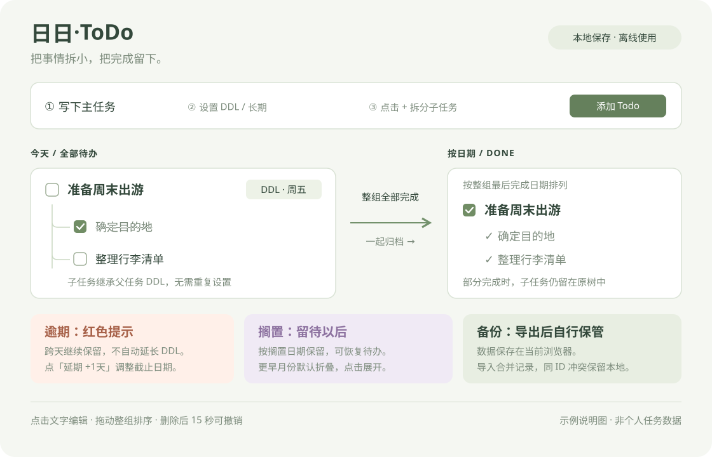

# 日日·ToDo

一个离线使用的轻量任务网页：用任务树组织待办，按日期回顾完成与搁置。无需账号、联网、安装依赖或服务器。



## 打开程序

双击 `index.html`，使用固定的浏览器和用户配置打开。更新后按 **Ctrl + F5** 刷新。

请将 `index.html` 和 `assets/` 保留在同一目录。日常使用时保持入口文件的位置不变：数据保存在浏览器中，换浏览器、移动入口路径或清理网站数据可能导致原记录不可见，搬迁前先导出备份。

## 使用方式

| 操作 | 入口 |
| --- | --- |
| 新增 | 填写事项，选择 DDL 或长期，点击添加或按 Enter |
| 添加子任务 | 新增区「+ 子任务」；已有父任务前的圆形「+」 |
| 编辑文字 | 点击任务文字，在页面内修改并保存 |
| 完成与恢复 | 勾选或取消勾选方框 |
| 搁置、修改 DDL、延期 | 父任务右侧「⋯」菜单 |
| 调整顺序 | 拖动父任务左侧点阵把手；聚焦把手后也可按上下方向键 |
| 删除 | 父任务菜单或子任务右侧「×」，使用自定义确认框确认 |
| 撤销删除 | 底部独立记录中的撤销按钮，15 秒倒计时 |
| 查看历史 | Log 右侧选择日期，自动展开月份并定位 |

子任务仅保留文字、完成勾选和删除，所有层级都继承父任务 DDL。旧的多级关系继续保留；当前界面从主任务入口添加子任务。

## 日期与状态

- 今天左栏显示所有待办，包含未来截止事项。未完成任务跨天继续保留；逾期显示红色，并优先排列。
- DDL 默认今天，与长期互斥。跨天不会自动延长 DDL。「延期 +1天」取原 DDL 与今天中较晚的一天，再加一天；长期任务不显示延期。
- 整个任务树全部完成后才进入 Done，按整组最后完成日归档。部分完成子任务仍留在原树中。
- 搁置按实际搁置日期显示在左栏，今天的搁置有独立分区。整组没有待办时，已完成子任务仍随搁置组显示，不单独进入 Done。
- 父任务有未完成子任务时，完成前会询问是否全部完成；搁置可选择一起搁置待办子任务或仅搁置父任务。
- 恢复子任务为待办，或向已完成父任务添加子任务，会恢复相关已完成上级。
- 更早月份默认折叠，统计当前完成和搁置数量，包含父任务与子任务，不是累计操作次数。

拖动时整张任务树作为等高占位区，其他卡片平滑让位，直接预览最终顺序。放下才保存，取消拖动恢复原位置。只能在同一日期、状态显示分区和优先分组内排序，不改变父子关系或状态；逾期任务仍优先显示。

文本、DDL、子任务和导入确认都在页面内操作。菜单、编辑区域、删除确认和撤销提示使用轻量动画，遵循系统的「减少动态效果」设置。

只有删除支持撤销。连续删除会显示多条记录，每条独立倒计时 15 秒，恢复不会回滚其他编辑。若分别删除子任务与父任务，请先恢复父任务。撤销记录到期、刷新或同步其他窗口后失效。

## 保存与备份

数据自动写入当前浏览器的 `localStorage`，关闭页面、退出浏览器或重启电脑后仍可保留。程序文件夹和 `backups` 不会自动收到数据文件。

定期点击「导出备份」，将下载的 JSON 保存到安全位置，也可自行放入 `backups` 目录。

### 导入始终合并

导入前显示预览，确认后按任务 ID 合并：

| 情况 | 结果 |
| --- | --- |
| 备份是新的任务 ID | 追加记录 |
| 相同 ID、相同内容 | 跳过重复 |
| 相同 ID、不同内容 | 保留本地，计为冲突 |
| 本地已有、备份没有 | 保留本地 |
| 相同文字、不同 ID | 保留为两条任务 |

重复导入不会重复添加相同 ID。旧备份中已删除的任务可能重新出现，因为备份不包含删除历史。导入不提供撤销。

无效日期、重复 ID、循环层级、不支持的版本或超过 10 MB 的文件会被拒绝。保存前检查其他窗口是否修改数据，避免旧窗口覆盖新内容；提示冲突时请刷新。更新后请刷新所有打开的旧页面。

### 数据格式与兼容

当前存储格式为 `schemaVersion: 2`，通过扁平数组与 `parentId` 保存任务树：

```json
{
  "schemaVersion": 2,
  "revision": 1,
  "tasks": [{
    "id": "example-id",
    "text": "签署合同",
    "parentId": null,
    "state": "pending",
    "order": 0,
    "createdDate": "2026-10-19",
    "completedDate": null,
    "heldDate": null,
    "deadline": { "mode": "date", "date": "2026-10-20" }
  }]
}
```

- `state`：`pending`（待办）、`completed`（完成）、`held`（搁置）。
- `deadline.mode`：`date`、`long` 或 `inherit`；长期、继承模式的 `date` 为 `null`。子任务 DDL 根据父任务解析，旧的独立子任务 DDL 统一改为继承。
- 创建日期固定，完成、搁置保留最近一次操作日期，不保存完整事件时间线。
- 导出文件在数据外包含 `format: "ririto-backup"`、`schemaVersion`、`exportedAt` 和 `data`。旧版备份仍可导入。
- 存储键保持 `daily-todo-v1`，兼容现有记录；内容已使用 v2。首次迁移前的原文保留在 `ririto.before-schema-v2`，仍在同一浏览器内，不能代替文件备份。

## 调试日期

右上角「调试日期」可临时设置程序中的今天，检查跨天、逾期及月份折叠。刷新或点击「恢复真实日期」退出，不修改系统时钟。

调试会影响新增、完成、搁置、默认 DDL 和延期计算。**调试期间的任务操作仍会保存**，恢复真实日期不会撤销操作。

## 文件结构与维护

```text
DailyTodo/
├─ index.html                  页面入口与结构
├─ assets/
│  ├─ todo.css                 布局、任务树与动效
│  ├─ task-model.js            校验、迁移、层级、排序、合并
│  ├─ task-storage.js          浏览器存储与保存冲突保护
│  └─ todo-app.js              页面渲染与交互
├─ tests/
│  └─ regression.test.cjs      数据与交互回归测试
├─ docs/
│  └─ overview.svg             使用流程说明图
├─ README.md                   使用与维护说明
└─ backups/                    可选，用户自行保存备份
```

模型、存储、界面按顺序通过经典脚本加载，支持本地 `file://` 打开，无需构建或 npm 安装。文件重命名不改变数据格式及存储键。

已安装 Node.js 时，在程序目录执行：

```sh
node tests/regression.test.cjs
```

测试覆盖迁移、校验、DDL 继承、合并、父子归档、存储失败及并发保护、调试日期、连续删除撤销和拖动预览、取消与保存。界面测试使用 DOM 替身，真实浏览器的布局和原生拖动仍需人工检查。
